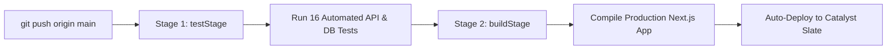

<div align="center">

# Roadmap.ai

**Learn Tech from Scratch, Step by Step.**

*Easy-to-follow roadmaps with interactive lessons and progress tracking. No prior experience required — anyone can learn.*

[](https://nextjs.org/)
[](https://www.typescriptlang.org/)
[](https://catalyst.zoho.com/)
[](https://catalyst.zoho.com/)
[](https://catalyst.zoho.com/)

[**🌐 Live Application**](https://roadmap-ai-ashah.onslate.in) · [**🔐 Admin Portal**](https://roadmap-ai-ashah.onslate.in/login?role=admin) · [**🎓 Learner Portal**](https://roadmap-ai-ashah.onslate.in/login)

</div>

---

## 🌟 Overview

**Roadmap.ai** is an interactive, full-stack tech engineering curriculum platform deployed on **Zoho Catalyst (Slate + Cloud Data Store)**. Designed to take anyone from absolute zero to job-ready developer, it provides structured visual milestone pathways across core technology disciplines—featuring hands-on concept readers, interactive checkboxes, real-time progress persistence, verified completion certificates, and a protected **Admin Curriculum Studio**.

---

## 🚀 Key Features

- **Beginner-Friendly Tech Pathways**:
  - **DevOps Engineering** (`/roadmap/devops`) — Linux OS, Networking, Git, Docker, Kubernetes, CI/CD, Terraform.
  - **Cloud Architecture (AWS)** (`/roadmap/cloud`) — AWS Core Services, IAM, VPC Networking, EC2, S3, RDS, Serverless.
  - **Frontend Engineering** (`/roadmap/frontend`) — HTML/CSS, Modern JavaScript, React 19, Next.js, Tailwind CSS.
  - **Backend Engineering** (`/roadmap/backend`) — Node.js, Go, Python, REST APIs, GraphQL, Databases, Caching.
  - **Full Stack Development** (`/roadmap/fullstack`) — End-to-end web apps with TypeScript, Next.js, and ORMs.
  - **AI & Machine Learning** (`/roadmap/ai-ml`) — Python, PyTorch, Deep Learning, LLMs, Vector DBs & RAG.
  - **Cybersecurity & Ethical Hacking** (`/roadmap/cybersecurity`) — OWASP Top 10, Network Penetration, Cryptography.
  - **System Design & Architecture** (`/roadmap/system-design`) — High-throughput systems, Load Balancing, Kafka, Sharding.
- **Dual Theme System**: Beautiful, high-contrast Periwinkle, Sage, and Peach design tokens with light/dark theme toggling.
- **Enterprise-Grade Authentication & Security**:
  - Cryptographic **JWT session tokens** (`jose` with `HS256`).
  - **Bcrypt password hashing** with 10 salt rounds (no plain-text passwords).
  - Secure **`HttpOnly` + `SameSite=Lax` cookies** protecting against XSS and CSRF.
  - Role-Based Access Control (**Learner** vs **Admin**).
- **Verified Completion Certificates**: Client-side Canvas generator issuing deterministic credential verification IDs upon 100% track completion.
- **DevOps Automation (Catalyst Pipelines)**: Automated CI/CD pipeline (`catalyst-pipelines.yaml`) executing isolated unit tests, database verification, and Next.js production builds on every Git push.

---

## 🏗️ Cloud Infrastructure (Zoho Catalyst)

```mermaid
flowchart TD
    subgraph Client["User Browser"]
        UI["Next.js 16 & React 19 UI (Pastel / Dark Theme)"]
        Cert["HTML5 Canvas Certificate Generator"]
    end

    subgraph CatalystSlate["Zoho Catalyst Slate (Serverless Compute)"]
        Auth["JWT Session & RBAC Middleware"]
        API["Next.js Serverless API Route Handlers (/api/*)"]
        SDK["zcatalyst-sdk-node Engine"]
    end

    subgraph CatalystData["Zoho Catalyst Data Store (Cloud DB)"]
        Users[("Users Table")]
        Subjects[("Subjects Table")]
        Milestones[("Milestones Table")]
        Topics[("Topics Table")]
        Progress[("User_Progress Table")]
    end

    UI -->|HTTPS (TLS 1.3)| Auth --> API --> SDK
    SDK --> Users & Subjects & Milestones & Topics & Progress
    UI --> Cert
```

### 📊 Database Schema (Catalyst Data Store)

1. **`Users`** (`ID: 92290000000025008`) — `name`, `email`, `password`, `role`.
2. **`Subjects`** (`ID: 92290000000025375`) — `title`, `slug`, `description`, `icon`, `category`.
3. **`Milestones`** (`ID: 92290000000025744`) — `subject_id`, `title`, `description`, `sort_order`, `level`.
4. **`Topics`** (`ID: 92290000000034118`) — `milestone_id`, `title`, `description`, `resources`, `sort_order`.
5. **`User_Progress`** (`ID: 92290000000034487`) — `user_id`, `topic_id`, `completed`.

---

## 🔄 DevOps CI/CD Pipeline (`catalyst-pipelines.yaml`)



The pipeline runs in an isolated cloud runner sandbox:
1. **`testJob`**: Installs dependencies and runs the 16 automated tests in `tests/verify-api.ts`.
2. **`buildJob`**: Validates TypeScript types and compiles Next.js with Turbopack.
3. Protects live production data by executing all test mutations inside a sandboxed environment.

---

## 🛠️ API Reference

| Method | Endpoint | Access | Description |
| :--- | :--- | :--- | :--- |
| `POST` | `/api/auth/login` | Public | Authenticates user or auto-provisions new accounts. Sets `roadmap_token` cookie. |
| `POST` | `/api/auth/register` | Public | Creates new user account with bcrypt password hashing. |
| `GET` | `/api/auth/me` | Public | Returns current authenticated user session. |
| `POST` | `/api/auth/logout` | Public | Clears session cookie. |
| `GET` | `/api/subjects` | Public | Returns all 8 roadmaps with milestone and topic counts. |
| `GET` | `/api/roadmaps/[slug]` | Authenticated | Returns ordered milestones, topics, and user completion progress. |
| `POST` | `/api/progress` | Authenticated | Toggles topic completion (`completed: true \| false`). |

---

## 💻 Getting Started (Local Development)

### 1. Clone & Install
```bash
git clone https://github.com/Aangi-Shah1234/roadmap.ai.git
cd roadmap.ai
npm install
```

### 2. Run Automated Verification Tests
```bash
npm test
```
*Executes all 16 automated checks verifying users, roadmaps, milestones, topics, and auth.*

### 3. Run Development Server
```bash
npm run dev
```
Open [http://localhost:3000](http://localhost:3000) in your browser.

### 4. Deploy to Zoho Catalyst Slate
```bash
# Deploy to Development
catalyst deploy slate roadmap-ai -ni

# Deploy to Production
catalyst deploy slate roadmap-ai --production -ni
```

---

<div align="center">
  <sub>Built with ❤️ by Aangi Shah · Hosted on Zoho Catalyst</sub>
</div>
